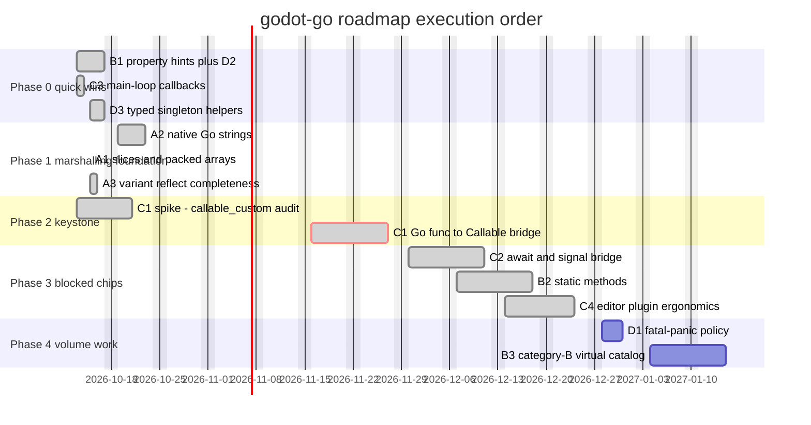
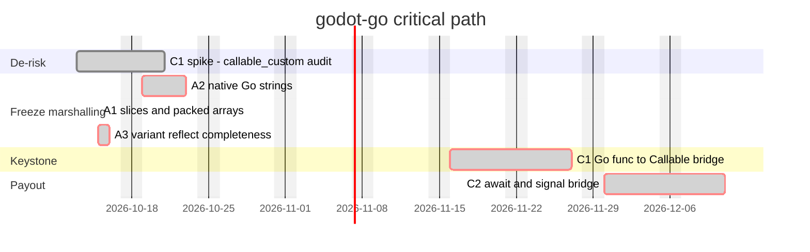

# Roadmap: Candidate Changes

A catalog of known gaps and TODOs in godot-go, shaped as possible OpenSpec
changes to dive into. Compiled 2026-10-13 from a repo-wide TODO sweep
(`TODO.md`, hand-written code markers, `docs/overview.md` limitations) and a
feature comparison against godot-cpp.

Tracked gaps that are already governed by an OpenSpec spec are not repeated
here; see `openspec/specs/` for what is contractually pinned.

## A - Marshalling gaps (FFI boundary types)

### A1. Go-native slices <-> Packed*Array

**DONE** — implemented by change `support-native-slice-marshalling` (2026-10-15):
`[]byte`, `[]int32`, `[]int`/`[]int64`, `[]float32`, `[]float64`, `[]string`,
`[]Vector2`, `[]Vector3`, `[]Vector4` and `[]Color` cross arguments and returns
against the matching `Packed*K` — all 10 packed types (the "9" below missed
`PackedVector4Array`). Decoded slices are Go-owned deep copies moved through
the engine `operator_index` accessors; Nil arguments are rejected by the
binder's strict conversion gate and unmappable elements (`[]bool`, wide unsigned,
`[]Vector2i`/`[]Vector3i`, `[]String`, nested) fail at bind time, all ratified
in spec `native-slice-marshalling`. Typed `Array[T]`/`Dictionary[K,V]`
generics were split out as their own follow-on change. Original item:

The loudest TODO in the codebase: any slice argument or return currently
aborts at the boundary.

- `pkg/core/method_bind_reflect.go:207,593` - `log.Panic("slice not implemented")`
- `docs/overview.md` "Packed Arrays" - conversion to Go native slices
  (e.g. `[]Vector2`) is not yet implemented

Scope: make all 9 `Packed*Array` types ergonomic from Go. Pairs naturally
with typed `Array[T]` / `Dictionary[K,V]` generics (godot-cpp's
`TypedArray<T>` / `TypedDictionary<K,V>` equivalents).

### A2. Native Go strings at method boundaries

**DONE** — implemented by change `ratify-string-marshalling` (2026-10-14):
the strict-vs-convert question is settled as convert-per-engine-table and
ratified in spec `string-boundary-marshalling`; `Copy()` retention helpers
landed on `String`/`StringName`/`NodePath`, and demo fixtures pin every
row of the marshalling table. The bind-time TODO now points at the spec.
Original item:

Binding a Go method that takes a plain `string` is an open question.

- `pkg/core/method_bind_reflect.go:199` - "TODO: how to support native go
  strings, StringName, and Godot String?"

Scope: small design decision (strict vs auto-convert at bind time), medium
blast radius on the variant encoder layer.

### A3. Variant reflect completeness

**DONE** — implemented by change `support-variant-reflect-completeness` (2026-10-15):
Ref values cross reflectively bound Go methods with ratified ownership on both
dispatch paths; every variant type decodes and encodes on both dispatch paths;
the synchronous 36-type audit closes the gaps the fixture matrix exposed and
retires the three stale citations below. Original item:

The "some real signatures still can't cross" bucket; A1/A2 feed into it.

- `pkg/core/variant_refect_value.go:75` - "TODO: add all types supported by variant"
- `pkg/core/method_bind_reflect.go:417,441` - open question whether Ref-typed
  returns are decoded as Refs
- `pkg/core/method_bind_reflect.go:1123,1131` - panics on missing Ref pointer
  type / missing user GD class constructor

## B - Class-model gaps (Godot features Go has no syntax for)

### B1. Property hints + PropertyInfo polish

**DONE** — implemented by change `support-property-hints` (2026-10-14):
`ClassDBAddPropertyInfo` + `PropertySpec` in `pkg/core`, class-name
derivation ported, hint/hint-string/usage delivered. Original item:

The only item in `TODO.md` itself: the ported `PROPERTY_HINT_RESOURCE_TYPE`
-> className logic has "no place to live".

- `TODO.md` - hint switch logic unplaced
- `pkg/core/classdb.go:141-143` - `PROPERTY_HINT_NONE`, empty hint string and
  `PROPERTY_USAGE_DEFAULT` are hardcoded in `ClassDBAddProperty`
- `pkg/ffi/property_info.go:25` - "TODO: create StringName locally here"

Scope: full `PropertyInfo` hint/hint_string/usage API surface. Nice-sized,
self-contained change; unblocks proper inspector UX for user classes.

### B2. Static methods and static variables

**DONE (methods)** — implemented by change `support-static-methods` (2026-10-16):
`core.ClassDBBindStaticMethod(inst, gdMethodName, fn, argNames, defaultValues)` binds a
Go package function (no receiver) against the class name resolved from `inst` with
`METHOD_FLAG_STATIC` — the parity counterpart of godot-cpp's `bind_static_method`. GDScript
calls it through the class path (`MyClass.some_static(...)`); the engine dispatches with a
null instance pointer, and static binds share the instance-path return-style, default-value,
variadic, and object-marshalling rules. The old stub TODO ("TODO: golang does not have
static methods") in `pkg/core/classdb.go` is gone, and `docs/overview.md` "Static Methods"
documents the shipped capability.

**BLOCKED (variables)** — no GDExtension ABI exists for registering a class variable:
`godot_headers/godot/gdextension_interface.h` has no `classdb_register_extension_class_variable`
(or equivalent) entry point, so no binding can register one; the earlier idea of mapping Go
globals onto GDScript static variables has no engine channel. Revisit if the experimental
LanguageExtension interface (unvendored) reaches stable Godot.

Scope note: the `cmd/generate` "refactor for static instantiation" notes are engine-class
call-side work and stay out of scope — engine functors already ignore the instance pointer
for statics, so those call sites work unchanged.

### B3. Generated virtual interfaces (Category B catalog)

`pkg/builtin/classes.interfaces.gen.go` carries 1,437
`TODO: Implement virtual method` comments, emitted by
`cmd/generate/builtin/classes.interfaces.go.tmpl`. This is the Category-B
virtual surface from `cmd/generate/gdclassimpl/virtual_census.json` (total
1,437 virtuals = 524 Category A cataloged + 913 Category B): bindable by
name today, but absent from the compile-checked `<Class>Virtuals` catalog.

Scope: expand the virtual surface catalog; the done-state is measurable (the
TODO comments disappear). Volume work.

## C - Runtime integration gaps (godot-cpp parity)

### C1. Go func -> Callable bridge

**DONE** — implemented by change `support-go-callable-bridge` (2026-10-16):
`core.NewGoCallable(func([]Variant) (Variant, error)) Callable` wraps a Go
closure as an engine custom Callable via `callable_custom_create2` with three
callbacks (call/free/to_string); the engine's `(call_func, callable_userdata)`
pair-identity gives dedup and copy-equality for free, and the `cgo.Handle`
registry releases entries deterministically in `free_func`. Original item:

`callable_custom_*` FFI wrappers were generated but unused; a Go closure or
method cannot be handed to GDScript as a `Callable`. Connecting a Go method
to a signal currently requires exposing it as a bound class method and
connecting from script.

Keystone dependency: C2, signal-connect-from-Go, and the
`docs/overview.md`-promised "goroutines to wrap signal and callable" pattern
all depend on this.

The flagged spike never needed running: `callable_custom_get_user_data` was
never missing from the engine. Four interface functions including it failed
to load because the codegen loader derived snake-cased Go identifier names
instead of the header `@name` metadata; change `fix-ffi-loader-names`
corrected the loader and the functions load by their published names.

### C2. Await / coroutine bridge

**DONE** — implemented by change `support-signal-await` (2026-10-16):
`core.Await(obj, signalName) <-chan AwaitResult` bridges one signal emission
to a Go channel — the goroutine blocks like GDScript's `await` while the
engine's main thread keeps running. Delivery is one-shot; the channel closes
after the emission, or without a send (`ok == false`) when the awaited object
is freed or teardown drops the connection, so a pending await can never hang
past the lifetime of what it waits for. Payloads are marshalled to Go-native
values on the emitting thread (scalars, strings, math POD structs, object
handles, bounded recursive Array/Dictionary, `AwaitOpaque` fallback), and the
returned channel composes with `select`, `time.After`, and `context`. The
liveness oracle is C1's deterministic free callback: `Await` destroys its Go
Callable reference immediately after the `CONNECT_ONE_SHOT` connect, so the
engine connection holds the only reference and its death - emission or object
death - finalizes the channel.

Scope note: the goroutine-based bridge to signals landed here; the
connect-a-Go-closure-to-a-signal pattern rides directly on C1
(`NewGoCallable` + `Object.Connect`) and is documented in `docs/overview.md`.

```
   [C1 callable bridge]
          |
    +-----+---------+
    v               v
 [connect Go    [C2 await/goroutine
  methods to     bridge to signals]
  signals]
```

### C3. Main-loop callbacks

**DONE** — implemented by change `support-main-loop-callbacks` (2026-10-13):
`InitObject.RegisterStartupCallback` / `RegisterFrameCallback` /
`RegisterShutdownCallback` mirror godot-cpp; CORE-level registration,
exported trampolines, pre-4.5 skip guard, and a mandatory shutdown-marker
gate in `make test`. Original item:

Godot 4.5+ exposes `register_startup_callback` / `register_frame_callback` /
`register_shutdown_callback` (godot-cpp `GDExtensionMainLoopCallbacks`).
godot-go has init levels and terminators but no frame hook.

Scope: cheap, standalone addition to `pkg/core` init plumbing.

### C4. Editor plugin ergonomics

**DONE** — implemented by change `support-editor-plugins` (2026-10-17):
`core.AddEditorPlugin[T](inst)` / `core.RemoveEditorPlugin[T](inst)` mirror
godot-cpp `EditorPlugins::add_by_type<T>()` / `remove_by_type<T>()`. A
mutex-guarded ordered class-name registry rejects duplicate adds and unknown
removals before anything crosses FFI; outside an editor session both refuse
with a recoverable panic (absent `EditorInterface` singleton — TOOLS-enabled
builds dispatch the EDITOR init level even in game runs, so extensions gate
on `Engine.is_editor_hint`). The registry auto-unloads at editor-level
deinitialization after the user terminator, mirroring
`GDExtensionBinding::deinitialize_level`. `make test` grew a second,
headless editor stage (`--editor --quit-after 12`) with its own gate: a
fixture plugin proves the engine instantiates Go plugin classes, a C1
composition probe crosses `AddToolMenuItem` with a Go `Callable`, and the
run must end leak- and orphan-clean. Original item:

The EDITOR init level is registerable, but there is no
`EditorPlugins::add_by_type<T>()`-equivalent registration or auto-unload
lifecycle. Bigger, and the test demo exercises runtime only.

## D - Robustness / polish

### D1. Fatal-panic policy for method resolution

Generated methods panic if the engine method pointer is missing
(~15,385 `panic("could not find method function ...")` sites), and the
ptrcall fast path has no `GDExtensionCallError` slot, so errors there
remain fatal (`docs/overview.md` "Call Error Reporting").

Scope: make resolution failures reported/recoverable instead of process-fatal.

### D2. Local StringName allocation

**DONE** — folded into B1 by change `support-property-hints`: the TODO was
replaced with an explicit ownership contract on `NewGDExtensionPropertyInfo`,
and `pkg/core` now owns all registration temporaries. Micro item; folds into B1.

### D3. Typed singleton helpers

**DONE** — implemented by change `support-singleton-accessors` (2026-10-13):
`singletons.go.tmpl` generates one typed, identity-stable accessor per
`singletons` entry into `pkg/gdclassimpl/singletons.gen.go`; the handwritten
`GetInputSingleton()` is replaced by the generated one. Original item:

Only `GetInputSingleton()` ships (`pkg/gdclassimpl/lib.go`); everything else
goes through `builtin.GetSingleton(name)` plus a manual
`New<Class>WithGodotOwnerObject`. Trivial, good codegen candidate for all
singletons.

### Micro leftovers (not proposals)

- `test/pkg/example.go:1211` - change bitfield test argument to
  `ExampleBitfieldFlag`
- `cmd/generate/gdclassimpl/classes.go.tmpl` /
  `cmd/generate/gdutilfunc/utilityfunctions.go.tmpl` - "refactor for static
  instantiation" notes (related to B2)

## Prioritization notes

- **B1** is the classic first good change: named in `TODO.md`,
  self-contained, unblocks real inspector UX.
- **A1 + A2** can ship as one "cross the boundary with native Go types"
  change, or split.
- **C1** is the highest-leverage and highest-risk item; spike the
  `callable_custom` engine-interface availability before proposing.
- **B3** is volume work with a clear, measurable done-state.

## Recommended implementation order

Ordering is driven by three axes:

- **Dependencies** - C2 needs C1; C4 needs C1 (tool-menu items take
  Callables) and C3; A3 is only inventoriably accurate after A1/A2; D2
  folds into B1.
- **Risk** - C1 is unknown until spiked (`callable_custom_get_user_data`
  gap on the current Godot build); the spike runs in parallel from day
  one while its implementation waits for frozen marshalling.
- **Churn** - A2, A1, A3, C1 and B2 all land in the same encoder /
  `method_bind_reflect` machinery. Doing them out of order means
  repeatedly rewriting each other, so the foundation settles first.
  B3 rewrites the generated interface surface and goes last, against
  settled templates.

The `Done` column is checked (`[x]`) once an item is implemented; the
item's section in the catalog above keeps the authoritative **DONE**
note naming the change that shipped it.

### Phase 0 - free quick wins (parallel-safe, zero conflicts)

| Done | Order | Item | Why now |
|---|---|---|---|
| [x] | 1 | B1 property hints (fold in D2) | Only `TODO.md` item; touches `classdb.go` / `property_info.go` and nothing else |
| [x] | 2 | C3 main-loop callbacks | Independent addition to init plumbing; cheap godot-cpp parity; C2 will want frame hooks to sit on |
| [x] | 3 | D3 typed singleton helpers | Trivial codegen; clears a parity gap immediately |

### Phase 1 - settle the marshalling foundation (strictly ordered)

| Done | Order | Item | Why here |
|---|---|---|---|
| [x] | 4 | A2 native Go strings | Small decision that A1, A3, C1 and B2 all inherit; decide strict-vs-convert once, early |
| [x] | 5 | A1 slices <-> Packed*Array (typed `Array[T]` split out) | Loudest TODO; builds directly on A2's string/element decisions |
| [x] | 6 | A3 variant reflect completeness | Its "what still can't cross" inventory is only accurate after A1/A2; also clears the Ref-output TODOs |

### Phase 2 - the keystone

| Done | Order | Item | Why here |
|---|---|---|---|
| [x] | 7 | C1 Go func -> Callable bridge | Highest leverage; needs the encoder layer frozen from Phase 1; the availability "spike risk" turned out to be the loader name bug fixed by `fix-ffi-loader-names` |

### Phase 3 - cash the blocked chips

| Done | Order | Item | Why here |
|---|---|---|---|
| [x] | 8 | C2 await / goroutine <-> signal bridge | Hard-blocked by C1; delivers the pattern `docs/overview.md` already promises |
| [x] | 9 | B2 static methods (DONE); static variables ABI-blocked | Wants settled marshalling for signatures; the `cmd/generate` "static instantiation" refactor notes are call-side and out of scope |
| [x] | 10 | C4 editor plugin ergonomics (DONE) | Soft-depends on C1 and C3 |

### Phase 4 - volume work against stable ground

| Done | Order | Item | Why here |
|---|---|---|---|
| [ ] | 11 | D1 fatal-panic policy | Worthless until A1/A3 stop adding/removing panic sites; policy debate, then mechanical sweep |
| [ ] | 12 | B3 Category-B virtual catalog | 900+ entries of codegen churn; cheapest once templates and interfaces have stopped moving |

### Gantt - master schedule

Dates are indicative durations for sequencing only, not commitments;
the order and the parallelism are the contract.



### Gantt - critical path spine

The serial chain the whole roadmap hangs on: the spike de-risks the
keystone, the frozen marshalling feeds it, and the await pattern is its
payout.



Two deliberate contrarian calls: B3 goes **last** despite being easy
volume work (churn before the ground settles is rebase pain with zero
functional unlock), and C3 goes **early** despite being parity-only
(cheap, independent, and C2 sits on top of it).

